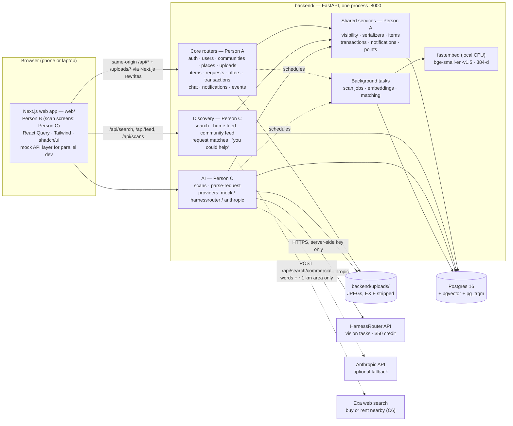
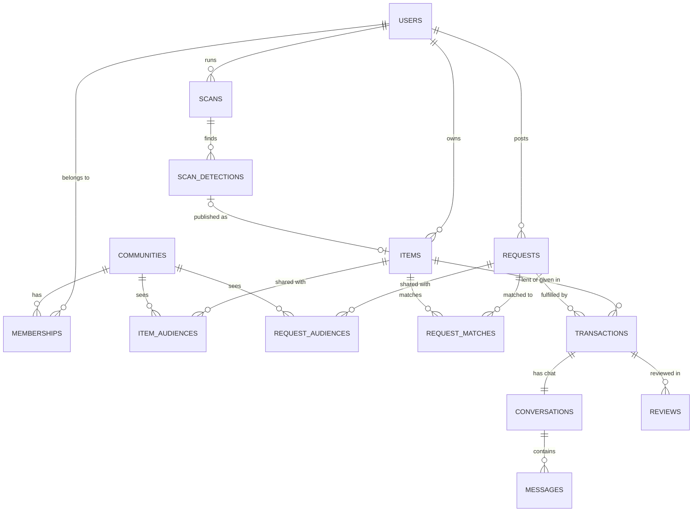
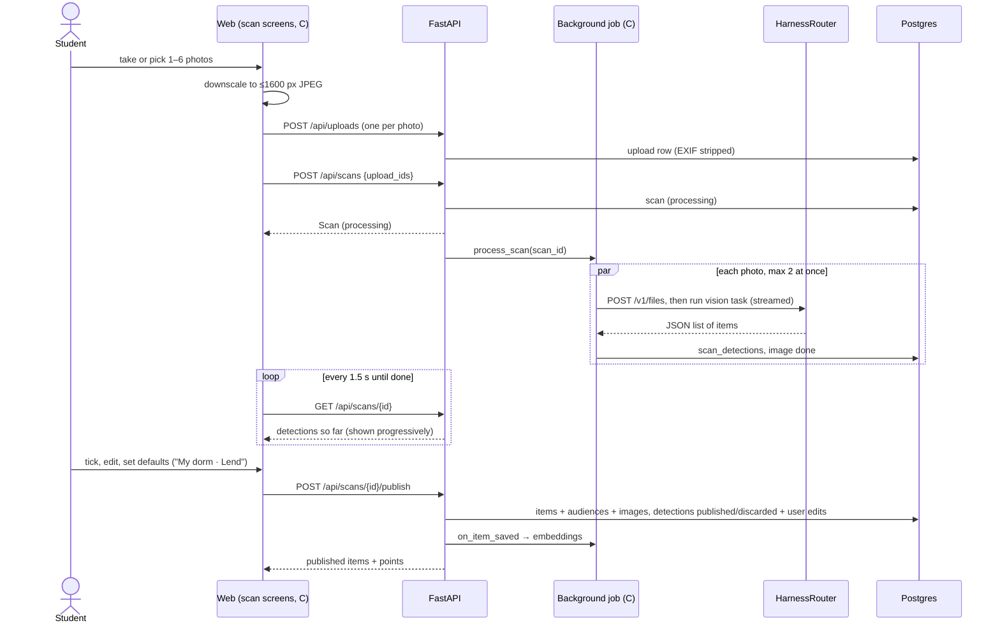
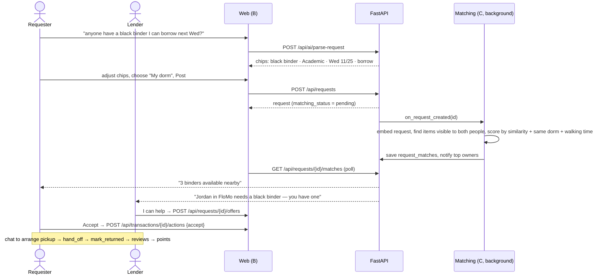
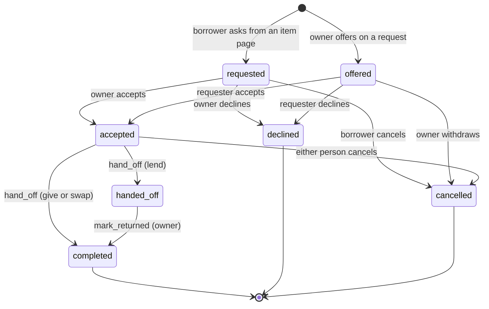

# DAHA architecture

One web app, one backend process, and one database, plus one external AI API. The pieces are deliberately few so that three people with AI coding agents can build in parallel without stepping on each other.

## 1. System overview



Plain-text version:
```
Browser ──/api/*──▶ Next.js rewrites ──▶ FastAPI :8000 ──▶ Postgres (+pgvector, pg_trgm)
  (B; C's scan pages)                    │  A: core routers + services     ▲
                                         │  C: discovery + AI ─────────────┘
                                         │  background: scans, embeddings, matching
                                         └──HTTPS──▶ HarnessRouter (vision)   [Anthropic optional]
                                         └──HTTPS──▶ Exa web search (buy or rent nearby, C6)
```

## 2. Tech stack

| Layer | Choice | Why |
|---|---|---|
| Frontend | Next.js (App Router, TypeScript), Tailwind, shadcn/ui, TanStack Query, react-hook-form + zod | Fast way to build a polished, mobile-first web app that runs in any phone browser |
| Backend | Python 3.12, FastAPI, SQLAlchemy 2, Alembic, Pydantic v2, `uv` | Simple and typed; Python suits the AI, ML, and evals work |
| Database | Postgres 16 with `pgvector` and `pg_trgm` (Docker) | Relational data, full-text, fuzzy, and vector search all in one database |
| Embeddings | `fastembed` with `BAAI/bge-small-en-v1.5` (local, 384 dimensions) | Free, private, and fast on a laptop CPU |
| Vision AI | HarnessRouter agent tasks behind a provider interface (`mock` / `harnessrouter` / `anthropic`) | Uses our $50 credit; swapping providers takes one env var |
| Auth | Email + password (bcrypt), JWT bearer token | Simplest thing that works for a demo |
| Files | Local disk (`backend/uploads/`) | Swap for S3 or R2 later |
| "Realtime" | Polling (chat every 3 s, badges every 20 s, scans every 1.5 s) | No websocket infrastructure needed |
| Hosting | localhost → Cloudflare quick tunnel → one VM running Docker Compose + Caddy | Cheap and simple |

## 3. One shared inventory; communities are visibility layers



- Campus, each dorm, and each club, class, or team are all **communities**. Every user is a member of the campus community, of one dorm, and of any number of groups.
- Each item and request has **audience** rows listing the communities that can see it:
  - campus visibility → [campus]
  - dorm visibility → [owner's dorm]
  - groups visibility → [the selected groups]
  - private visibility → [] (only the owner sees it; matching uses it only for anonymous pings)
- **Visibility rule:** a viewer can see an item or request if they own it, **or** if its audiences overlap the viewer's communities. One helper (`backend/app/services/visibility.py`, Person A) applies this rule everywhere: details, search, feeds, and matching. That way they can never disagree.
- There are no per-dorm tables and no duplicate inventories. A dorm page simply shows the shared data filtered through that dorm's audience.
- Full schema: `PLAN.md` §6.

## 4. Main flows

### 4.1 Photo scan → publish (the onboarding "wow")


### 4.2 Request → matches → offer → borrow


### 4.3 Transaction lifecycle

A `services` item stays `available` after a give or swap completes: helping one person doesn't use it up. The full rules (who may do what, plus side effects on items, requests, points, and notifications) are in `PLAN.md` §7.7. They live in a single module: `backend/app/services/transactions.py`.

### 4.4 Search
1. Rules (no LLM, so it's instant) parse the query into: cleaned text, category, "near me", "my dorm", dates like "this weekend", and type like "free".
2. Candidates are gathered from three places: vector similarity (pgvector), full-text search, and fuzzy name match (pg_trgm). All three are filtered by the visibility rule and the user's filters.
3. Each candidate gets a score = semantic + keyword + proximity (same dorm, walking minutes) + freshness, multiplied by an availability factor. A parsed category is a soft boost, never a filter, and a candidate with no keyword overlap must be semantically close to the best hit (`app/discovery/config.py`).
4. Every search is logged to `search_logs`, which later feeds learning-to-rank.

## 5. The AI provider layer
```
app/ai/vision.py ── cache (image sha256 + prompt version + model) ──▶ provider
                                                    ├─ mock          (dev and tests; free, deterministic)
                                                    ├─ harnessrouter (default for demos; agent task: upload file → run → JSON)
                                                    └─ anthropic     (optional; Claude vision with structured output)
```
- Every provider returns the same validated `DetectionPayload`. Switching providers means changing `AI_PROVIDER` in `backend/.env`.
- HarnessRouter runs full agent tasks, which can take tens of seconds. That's why scans are **background jobs with progressive results** instead of a blocking request.
- Embeddings and search never use paid APIs.

## 6. Background work (FastAPI BackgroundTasks, same process)
| Job | Trigger | Owner |
|---|---|---|
| `process_scan(scan_id)` | `POST /api/scans` | C |
| `on_item_saved(item_id)`: compute the embedding, then score the item against open requests (reverse matching for "You could help") | item create/update, scan publish | C (called by A) |
| `on_request_created` / `on_request_updated`: embed, match, notify | request create/update | C (called by A) |
| `reindex_all()` | `make seed`, `make reindex` | C |

Stuck scans (still processing after 10 minutes) are marked failed when someone next reads them. No cron is needed for the MVP.

## 7. Environments
```
Dev:      laptop — docker (Postgres) + `make api` + `make web` → http://localhost:3000 (phone: http://<laptop-ip>:3000)
Demo:     same laptop + `cloudflared tunnel --url http://localhost:3000` → temporary public HTTPS link
Hosted:   one small Ubuntu VM — docker compose (db, api, web) + Caddy (HTTPS) + nightly pg_dump
          → set up with one command: infra/deploy/deploy.sh (infra/deploy/OWNERACTIONS.md)
```

## 8. Security & privacy
- API keys are server-side only (`backend/.env`). The browser talks only to our own `/api`.
- Uploaded photos are re-encoded with all EXIF metadata removed, including GPS.
- Locations are dorm-level coordinates only. No room numbers or addresses are stored.
  - One exception: store search ("Buy or rent nearby") may use the phone's current location. It is rounded to ~1 km in the browser and again on the server, sent only in the POST body of `/api/search/commercial`, used only when the person allows it, and never stored or logged. Without it, store search uses Stanford campus. Everything peer-to-peer stays dorm-level (`plans/LOCATION.md`).
- The pickup note is visible only to the owner and to the counterparty of an accepted transaction.
- AI detections are drafts until the user explicitly publishes them. New listings default to **dorm** visibility.
- A resource the viewer isn't allowed to see returns **404**, never 403, so its existence isn't revealed.
- Photo AI spend has hard limits: per-user daily scan limit and a total budget (`AI_BUDGET_USD`).
- "Buy or rent nearby" (C6) sends Exa only the cleaned search words (no emails, phone numbers or links) and a ~1 km area: an opted-in phone location, a spot picked on the map, a typed ZIP, town, or coordinates, or Stanford campus, plus that area's country (worked out offline). No names or ids; coordinates are never stored. It has its own daily cap and monthly budget (`COMMERCIAL_*`).
